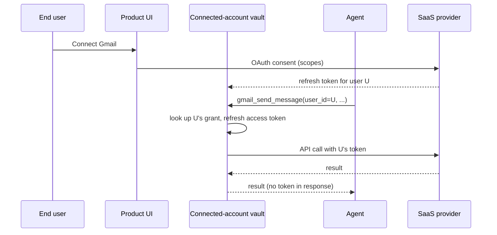

## Problem

Agents that do real work in SaaS applications, such as drafting email, updating a CRM deal, or filing an issue, must authenticate to those applications. The naive approaches both fail at multi-user scale:

- **Shared credentials**: one service account or API key is used for every user. The agent can reach data its current user is not allowed to see, audit logs attribute every action to the service account, and revoking one user's access means rotating a credential shared by everyone.
- **Tokens in the loop**: each user's OAuth token is handed to the agent and placed in context or tool arguments. Tokens leak into transcripts, logs and prompt-injection exfiltration paths, and the agent code has to own refresh, expiry and per-provider quirks for every integration.

Multi-tenant agent products therefore need authorization that is scoped to the acting user, invisible to the model, and maintained outside the agent runtime.

## Solution

Separate the *grant* from the *call*.

1. **Connect once per user.** The product sends the user through the third-party provider's OAuth consent flow (or an API-key capture form where OAuth does not exist). The resulting grant is a **connected account**: a tuple of (user identity, provider, scopes, refresh token) stored in a vault that the agent cannot read.
2. **Call with an identifier, not a secret.** The agent calls a tool such as `gmail_send_message` with the *user's identifier*. The integration layer resolves the identifier to that user's connected account, refreshes the access token if needed, and performs the call with the user's credential.
3. **Scope at the layer, not in the prompt.** The set of tools exposed to a given agent or role is enforced by the integration layer (allowlists, read-only variants, per-tool policy), so the model cannot talk its way into actions the user did not authorize.
4. **Attribute every call.** Because each call carries a user identity and a connected account, the audit log records which agent, which user, which tool and what came back, and the provider's own logs show the human, not a bot account.



```pseudo
// Agent side: identity in, data out, no secrets
result = tools.call("gmail_send_message", user_id=current_user, to=..., body=...)

// Integration layer (outside the agent runtime)
grant = vault.lookup(user_id, provider="gmail")       // fails if the user never connected
token = grant.access_token or refresh(grant)           // refresh handled here
policy.assert_allowed(agent_role, "gmail_send_message")
return provider.call(token, ...)                        // response is sanitized of credentials
```

## Evidence

- **Evidence Grade:** `medium`
- **Most Valuable Findings:**
  - Delegated OAuth with a server-side token store is the standard model recommended by the OAuth 2.0 and OAuth 2.1 specifications for third-party access on a user's behalf; it is how user-facing integrations in products such as Zapier and Slack apps have worked for a decade.
  - Several agent-integration products converge on the same shape (connected accounts resolved by user id at call time, tokens never returned to the caller): Composio, Arcade, Nango, Pipedream Connect and Scalekit all document it as their primary mode.
- **Unverified / Unclear:** how well per-user scoping holds up when agents chain sub-agents that run as different principals; prompt-injection resistance depends on the layer's policy enforcement, not on the pattern alone.

## How to use it

- Use it whenever an agent product has many end users and acts inside systems that hold user-specific data.
- Prerequisites: an OAuth app registration per provider (or a managed integration layer that supplies one), a durable store for refresh tokens with encryption at rest, and a stable user identifier the agent can pass.
- Keep the vault and the policy check in a service the agent runtime cannot bypass. A tool that accepts a raw token argument defeats the pattern.
- Request minimal scopes at connect time, and offer read-only tool variants so the same grant can back a cautious agent and a write-capable one.
- Log at the integration layer, with user id, agent id, tool name and result status, and forward to the SIEM where the rest of the application's audit lives.
- Implementations: build it over the provider's OAuth docs plus a secrets store, or adopt a managed integration layer. Open-source references include Nango and Composio's SDK; hosted options include Arcade, Pipedream Connect and Scalekit.

## Trade-offs

- **Pros:** per-user least privilege; revocation per user; provider-side audit shows the human; tokens never enter the model context; refresh and provider differences are handled once rather than per agent.
- **Cons:** an extra service in the request path (latency, availability dependency); consent UX that each user must complete per provider; OAuth app review and verification per provider; the vault becomes a high-value target and needs encryption, rotation and access controls of its own.

## References

- [The OAuth 2.0 Authorization Framework (RFC 6749)](https://datatracker.ietf.org/doc/html/rfc6749)
- [OAuth 2.1 draft](https://datatracker.ietf.org/doc/html/draft-ietf-oauth-v2-1)
- [Nango: connections and OAuth](https://docs.nango.dev)
- [Composio: connected accounts](https://docs.composio.dev/docs/authenticating-tools)
- [Arcade: user authorization](https://docs.arcade.dev)
- [Scalekit AgentKit: connect users and authorize a user](https://docs.scalekit.com/agentkit/overview/)
- Related patterns: [Unified Tool Gateway](unified-tool-gateway.md), [External Credential Sync](external-credential-sync.md)
